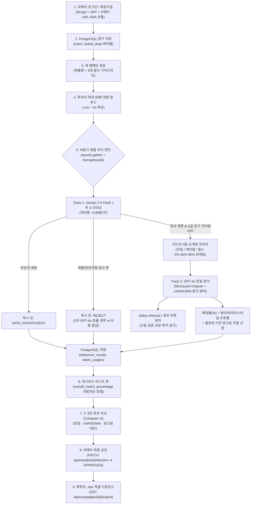

# InfluenceOps — 최종 기획서 및 발표자료

> **B2B 뷰티·라이프스타일 인플루언서 협찬 의사결정 지원 AI SaaS (Phase 2 MVP)**  
> *"1명씩 대조하는 비효율을 없애고, 브랜드 DNA 기반 투트랙 AI 라우팅으로 50명의 후보자를 1분 내에 스코어링·비교·확정합니다."*

---

## 1. 시스템 동작 플로우 도식화 (Mermaid Diagram)

회원가입 시 추출한 브랜드 DNA를 기준점으로, 50명의 후보자를 비동기 병렬(`asyncio.gather`) + 투트랙 AI 라우팅으로 처리하여 마케터의 최종 승인 및 실무 엑셀 추출까지 이어지는 전체 아키텍처 흐름입니다.

---

## 2. LLM 벤치마크 & 투트랙(Two-Track) 비용 최적화 전략

### ① 파인튜닝 폐기 및 프롬프트 + Pydantic 스키마 채택 근거
- **멘토링 피드백 반영**: 초기 Phase 3으로 고려했던 별도 모델 파인튜닝 계획을 전면 폐기했습니다.
- 대신 **프롬프트 엔지니어링 + Pydantic `Structured Outputs`** 만으로 100% 스키마 안정성을 확보했으며, 특히 미확인 정보(피부 타입, 가족/반려동물 노출 등)를 임의로 추측하지 않도록 **`UNKNOWN(파악 불가)` 강제 통제 로직**과 **OpenAI `Safety Refusal` 명시적 예외 처리**를 구현했습니다.

### ② LLM 벤치마크 & 투트랙 라우팅 비교 (`poc_tests/poc_model_benchmark.py` 및 실측 기반)

| 구분 | 단일 GPT-4o 단독 처리 | 1차 Gemini 2.5 Flash | **InfluenceOps 투트랙 라우팅 (채택)** |
| :--- | :---: | :---: | :---: |
| **역할** | 전 인원 정밀 분석 | 1차 대량 스크리닝 (봇/비공개 컷) | **1차 Gemini Flash ➔ 2차 생존자만 GPT-4o** |
| **응답 속도 (Latency)** | 평균 약 2.93초 / 1인 | 1초 내외 (초고속) | **50명 기준 비동기 병렬 처리로 대폭 단축** |
| **스키마 안정성** | 100% (Structured Outputs) | 100% (JSON Mode) | **100% 안정성 유지** |
| **1인당 API 비용 (KRW)** | 약 **13.9원** | 약 **0.89원** (약 1/15 가격) | **E2E 실측 평균 약 10.8원** (4명 테스트 시 **13.39원, 75.9% 절감**) |

> **실제 E2E 검증 결과 (`token_usages` 테이블 실측)**:
> - 4명 혼합 테스트(정상 2 + 광고봇 1 + 비공개 1): 단독 GPT-4o 예상 비용 `55.6원` ➔ 투트랙 실제 비용 `13.39원` (**75.9% 비용 절감**)
> - 7명 실제 공개 계정 테스트: 총 `76.01원` (인당 **약 10.8원**)으로 멀티모달 이미지 3장 분석 + 원고료 + 매칭률 산정 완료.

### ③ Streamlit 대신 React + FastAPI(MSA) 채택 이유
- **Streamlit(Phase 1 PoC)**: AI 프롬프트 및 크롤링 로직의 빠른 검증 용도로만 활용했습니다.
- **React(Vite) + FastAPI(Phase 2 MVP)**: 상용 B2B SaaS 대시보드에서 필수적인 **고속 리스트 정렬, 체크박스 다중 선택 ➔ 좌우 비교(Compare UI), JWT 세션 유지, 비동기 백그라운드 처리**를 매끄럽게 구현하기 위해 프론트엔드와 백엔드를 완전 분리했습니다.

---

## 3. 비즈니스 ROI 시뮬레이션 비교표

마케터 1명이 캠페인당 후보자 **50명**을 검수·섭외하는 실무 기준 비교표입니다.

| 평가 지표 | 기존 마케터 수동 검수 | InfluenceOps 도입 후 | 개선 효과 (ROI) |
| :--- | :--- | :--- | :--- |
| **후보자 50명 검수 시간** | 약 45~60분 (1명당 1분 내외 일일이 피드·캡션 확인) | **약 1분 이내** (비동기 병렬 분석 후 점수순 리스트 확인) | **검수 시간 95% 이상 단축** |
| **광고 봇 / 비공개 필터링** | 직접 클릭해 들어가야 확인 가능 | **1차 Gemini Flash 자동 컷** (`REJECT` / `판독불가`) | 불필요한 클릭 시간 0초 |
| **후보자 비교 및 선정** | 엑셀/메모장에 URL 복붙하며 1명씩 대조 | **리스트 상위 정렬 + 체크박스 2인 좌우 비교 모달** | 의사결정 피로도 획기적 감소 |
| **미스매칭 매몰 비용 (Sunk Cost)** | 부적합 인플루언서 제품 발송·원고료 낭비 (건당 30만 원+) | 브랜드 DNA + 5대 가이드라인 사전 충돌 경고 | **오발송·미스매칭 손실 사전 차단** |
| **시스템 API 운영 비용** | 마케터 인건비 중심 | **50명 기준 약 200~540원 수준** (`token_usages` 추적) | SaaS 월 구독 모델(예: 39,000원) 충분한 마진 확보 |

---

## 4. 실무 마케터 사용자 시나리오 (User Journey Story)

> **페르소나**: 클린뷰티 스킨케어 브랜드 마케터 김민지 매니저 (월요일 오전 9시)

1. **온보딩 & 브랜드 DNA 연결 (`P.2 ~ P.5`)**
   - 김 매니저는 InfluenceOps에 자사몰 URL(`https://www.innisfree.com`)을 입력해 회원가입합니다.
   - AI가 자사몰을 분석해 *"자연광, 깨끗한 피부결, 과도한 광고 배제"*라는 **브랜드 DNA**를 추출해 PostgreSQL(`brand_dnas`)에 영구 저장합니다. 이후 수정이 필요할 때는 설정 화면(`P.13`)에서 언제든 텍스트를 다듬거나 URL 재추출이 가능합니다.

2. **캠페인 등록 & 50명 대량 업로드 (`P.6 ~ P.8`)**
   - 신제품 *"저자극 시카 수분 앰플"* 캠페인을 만들고 5대 가이드라인(타깃 고객, 무드, 제형 컷 필수 등)을 입력합니다.
   - 리스트업해 둔 인플루언서 50명의 아이디가 담긴 `.csv` 파일을 드래그앤드롭하고 `[분석 시작]`을 누릅니다.

3. **투트랙 AI 분석 & 점수순 리스트 뷰 (`P.9`)**
   - 약 1분 뒤 대시보드에 50명의 결과가 **매칭률(%) 높은 순**으로 자동 정렬됩니다.
   - 1차 Gemini Flash가 걸러낸 특가 전단지 광고 봇(`REJECT`)과 비공개 계정(`판독 불가` 툴팁)은 건너뛰고, 상단의 `85%`, `75%` 추천 크리에이터들만 확인합니다.

4. **2인 좌우 비교 & 최종 확정 엑셀 다운로드 (`P.10 ~ P.12`)**
   - 상위권 후보 `@mew_demure`(민감성 피부, 나노 0원 시딩)와 `@chai._.beauty`(2.6만 팔로워, 10~15만 원) 2명을 체크박스로 선택해 **[2인 비교하기]**를 누릅니다.
   - AI가 *"피부 타입이 피드에서 확인되지 않아 `UNKNOWN` 처리함"*을 정직하게 알려주어 착오 없이 판단한 뒤 **[✅ 최종 승인]**을 누릅니다.
   - 마지막으로 `[승인 목록 내보내기 ↓]` 버튼을 눌러, 승인된 인플루언서와 예상 원고료·AI 판정 사유가 깔끔히 정리된 `.xlsx` 엑셀 파일을 내려받아 오전 9시 15분 만에 협찬 DM 발송 업무를 시작합니다.
